# Meta Ads Audit — Public Tender Company, 30 days

A senior-media-buyer audit of a 30-day Meta Ads (Facebook + Instagram) export for a **public tender company**. It was produced with the [`meta-ads-audit`](docs/SKILL_EXPLAINED.md) skill for Claude. The skill is a rule-based audit framework: health check → conversion metric → structure → ad sets → Pareto → creative. It also has built-in guardrails that stop it from recommending moves that would hurt a working account.

> **Data note:** the export in `data/` is **dummy data** shaped like a real Ads Manager export (17 Sep – 16 Oct 2026, EUR, 30 ads, 6 campaigns). The numbers are illustrative; the method is real.

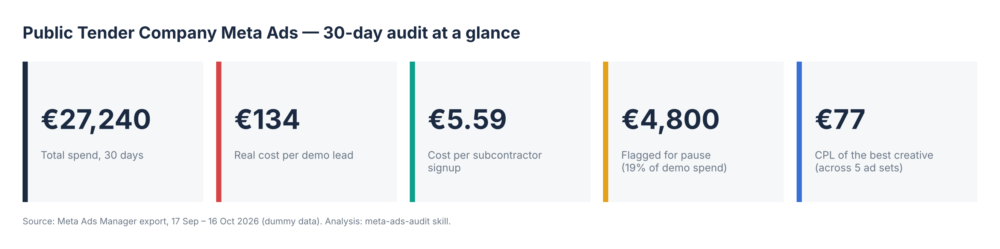

---

## TL;DR for the Marketing Lead

1. **The account's headline CPL is wrong by almost 3×.** The "Leads" column mixes demo requests from buyers with free subcontractor signups. Blended, a lead costs **€48**. A demo lead — the one sales actually works — costs **€134**.
2. **One video carries the business.** The *AI Price Assistant · Demo Walkthrough 30s* produced **88 of 188 demo leads at €77**, across 5 ad sets. A new UGC test (*Bauleiter Reaction 20s*) matches its best CPL (**€60**) and isn't in the main campaign yet.
3. **About €4,800 (19% of demo spend) bought 6 leads.** That money went to the Architects interest ad set, two poor-hook videos, a zero-lead image in AT+CH and a bid cap set too low to deliver. Pausing it is the cleanest win in the account.
4. **Broad beats clever.** Broad Germany delivers demo leads at **€102**. Role-based interest targeting delivers them at **€261**, and bid caps don't beat no cap.
5. **The bottleneck is after the click.** Demo campaigns turn **1–3%** of landing-page visitors into leads, compared with **11%** for the free signup. CTR is fine. The landing page and offer are where the next big gain sits.

→ Full write-up: [`docs/AUDIT_REPORT.md`](docs/AUDIT_REPORT.md) · Checklist to apply in Ads Manager: [`docs/ACTION_PLAN.md`](docs/ACTION_PLAN.md)

---

## The findings, in charts

### 1. Two different leads hide in one column

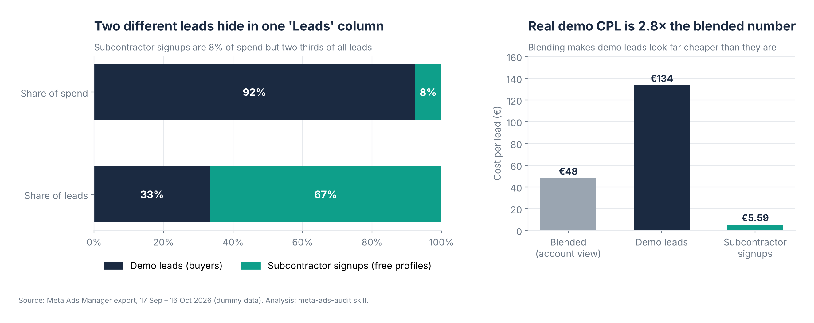

Subcontractor signups are 8% of spend but 67% of all leads. Any dashboard that averages them makes demo acquisition look cheap. From here on, every demo metric is measured against **€134 per demo lead**.

### 2. Which ad sets earn their budget

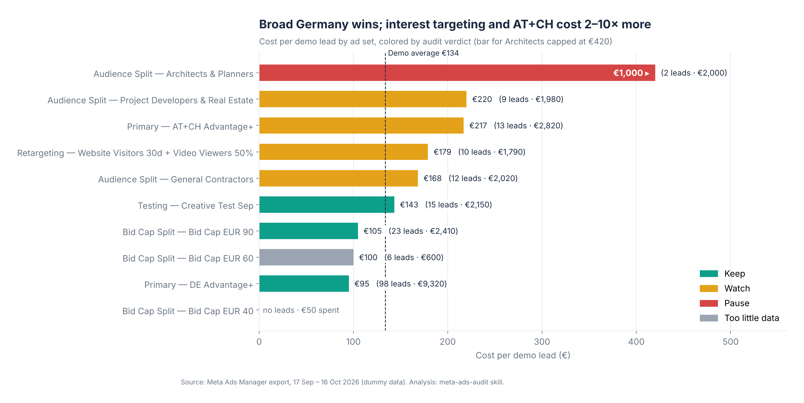

**Primary · DE Advantage+** is the workhorse: 98 leads at €95, using 89% of its budget. Interest targeting costs 1.3–7.5× the average. The Architects & Planners ad set spent €2,000 for 2 leads.

### 3. Demo leads are concentrated in a few ads

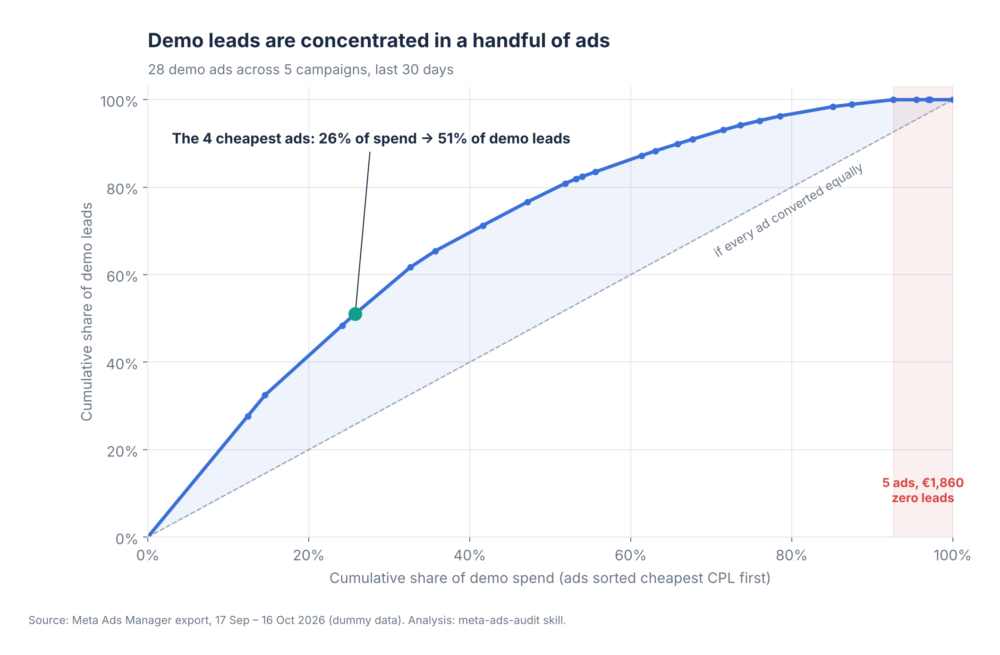

The four cheapest ads take 26% of spend and bring in 51% of demo leads. At the other end, five ads spent €1,860 with nothing to show for it.

### 4. Where the budget lands, ad by ad

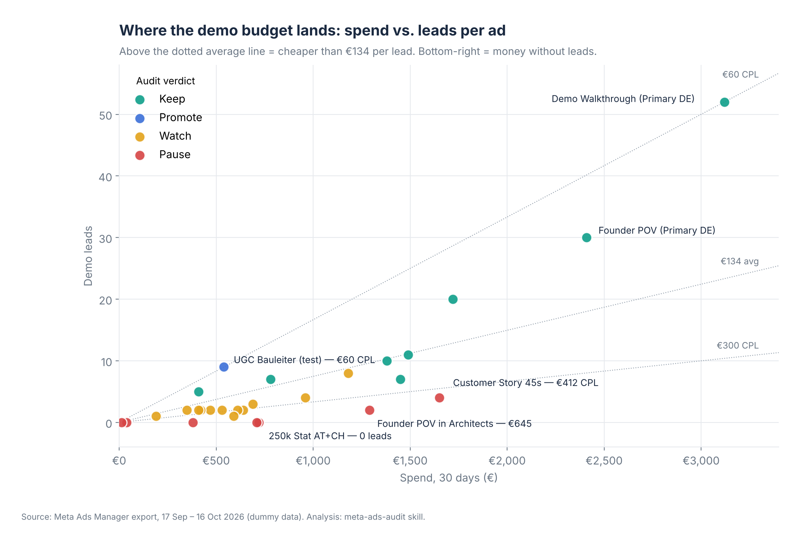

Each dot is one ad. Dots above the €134 line beat the average. The red dots in the bottom-right are where money goes in and leads don't come out.

### 5. Creative: the hook decides the CPL

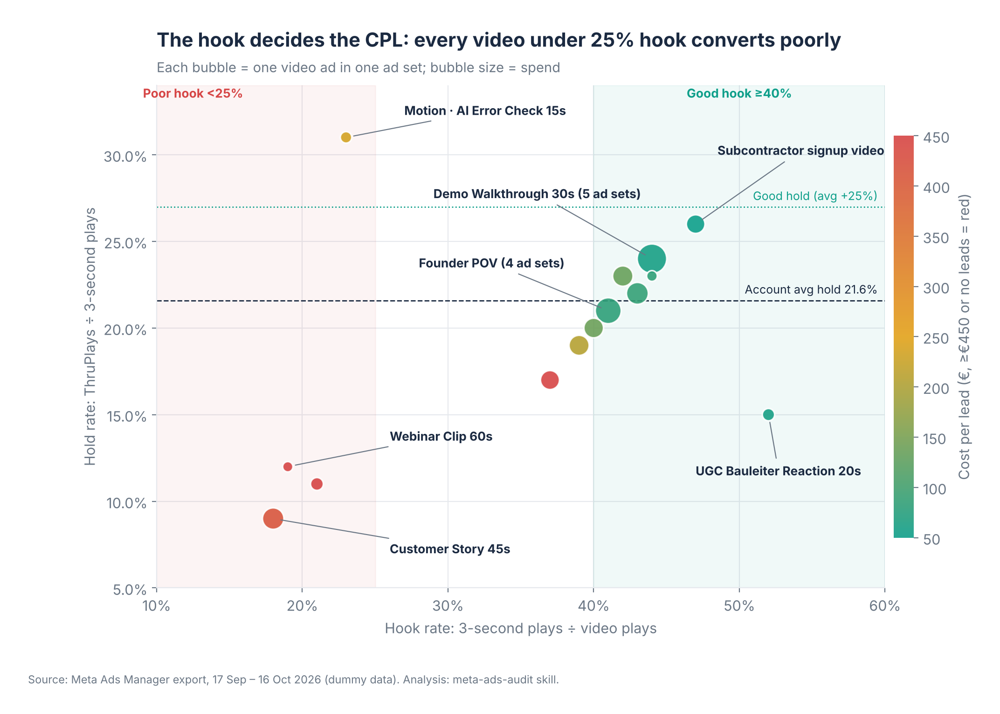

**Hook rate** is the share of viewers who watch past 3 seconds. **Hold rate** is the share of those who keep watching to a ThruPlay. Every video with a hook under 25% has a poor CPL: Customer Story 45s, Webinar 60s and Motion. The cheap leads all come from videos with a hook of 40% or more. *Motion · AI Error Check* is worth noting: it has the best hold in the account (31%) and a weak hook (23%). The fix is a new opening on the same body.

### 6. Creative leaderboard

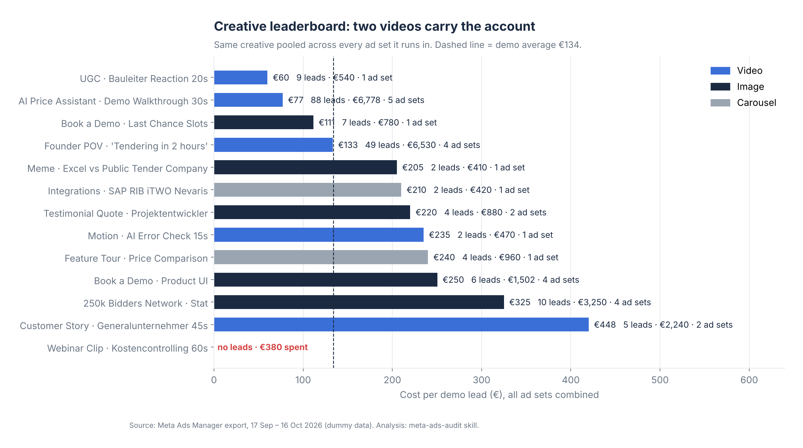

This chart pools each creative across every ad set it runs in. Two videos sit below the average CPL at volume. The *250k Bidders Network* image runs in 4 ad sets and averages €325 per lead.

### 7. Bid caps: lower caps barely spend

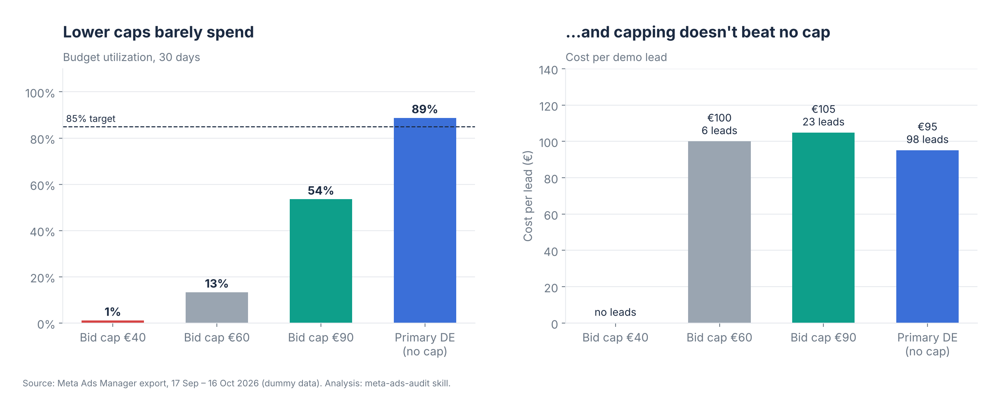

The €40 cap spent 1% of its budget. The €90 cap converts well but only spends 54%. No capped ad set beats the uncapped Primary DE ad set at €95.

### 8. Broad vs. interest targeting

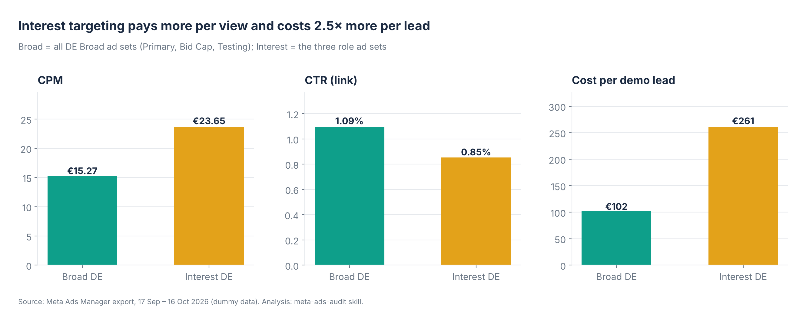

Interest audiences cost 55% more per thousand impressions, get clicked less, and cost 2.5× more per demo lead.

### 9. What the flagged spend costs

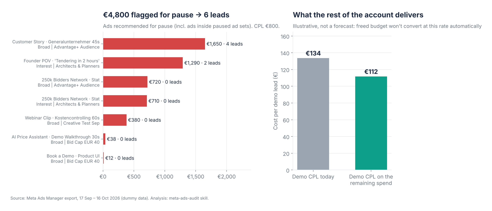

The ads recommended for pause spent €4,800 and produced 6 leads, an effective CPL of €800. The rest of the demo account runs at €112. This is illustrative, not a forecast: freed budget won't convert at that rate automatically.

### 10. The funnel breaks on the landing page

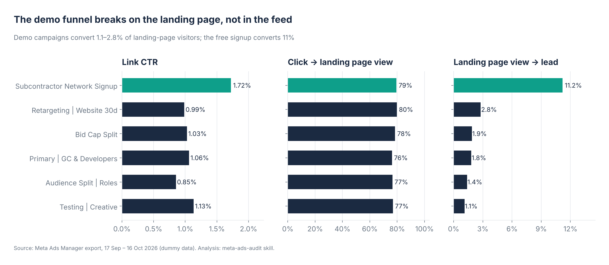

Click-to-landing-page rates are healthy everywhere, at 76–80%. The gap opens at the last step. If the demo landing pages converted even 3% instead of today's 1.7%, CPL would drop by roughly 40% without touching the ads.

---

## Top recommendations

All of these are for **you to apply in Ads Manager**. The skill is read-and-recommend only and never changes an account.

| # | Action | Why | Watch out |
|---|---|---|---|
| 1 | **Pause the Interest · Architects & Planners ad set** | €2,000 → 2 leads (€1,000 CPL) | Spend stops immediately; don't shift the budget automatically |
| 2 | **Pause 3 ads:** Customer Story 45s (Primary DE), 250k Bidders Stat (AT+CH), Webinar Clip 60s (Testing) | €2,750 → 4 leads; each passes the skill's pause test | None of them is the top converter in its ad set |
| 3 | **Move UGC Bauleiter Reaction 20s into Primary DE** | €60 CPL, 52% hook, best test result | Adding an ad can briefly re-enter learning; judge it after 7 days |
| 4 | **Turn off the €40 bid cap ad set**; optionally raise €90 → about €100 | The €40 cap can't win auctions; €90 converts but underspends | Changing a bid amount may reset learning |
| 5 | **Subcontractor campaign: +20% daily budget (€70 → €84)**, *if* signup quality is confirmed | 100% of budget spent at €5.59 per signup | Review after 7 days; roll back if CPL rises above about €7 |
| 6 | **Brief new creative:** new hooks on Demo Walkthrough, a new hook on the Motion body, a full rebuild of Customer Story | Hook rate is the strongest predictor of CPL here | — |
| 7 | **Landing-page test for demo traffic** | 1–3% LPV → lead vs 11% on the free signup | Outside Meta, but the biggest lever |

**Not recommended:** scaling Primary DE right now. It's already at 89% budget use, and there's no daily or segment data yet to confirm it can take more.

---

## What's in this repo

```
.
├── README.md                  ← you are here
├── data/
│   └── public_tender_company_meta_ads_export_30d_dummy.csv ← ad-level Ads Manager export (dummy)
├── analysis/
│   └── audit.py               ← reproduces every number and chart
├── assets/                    ← 11 charts used above (PNG, 200 dpi)
├── output/                    ← computed tables (CSV)
│   ├── conversion_groups.csv  ← demo vs subcontractor vs blended
│   ├── campaigns.csv
│   ├── adsets.csv             ← budget use, campaign share, CPL, verdict
│   ├── ads_demo_pareto.csv    ← every demo ad with cumulative spend % and verdict
│   ├── creatives.csv          ← each creative pooled across ad sets, hook + hold
│   └── flagged_spend.csv
└── docs/
    ├── SKILL_EXPLAINED.md     ← how the meta-ads-audit skill works
    ├── AUDIT_REPORT.md        ← the full audit, section by section
    └── ACTION_PLAN.md         ← checklist to apply + what data to pull next
```

## Reproduce it

```bash
pip install -r requirements.txt
python analysis/audit.py                          # uses the bundled dummy export
python analysis/audit.py path/to/your_export.csv  # or your own export
```

The script expects an **ad-level** Ads Manager export with these columns: spend, impressions, reach, frequency, CPM, link clicks, CTR, leads, landing page views, bid strategy, bid amount, ad set budget, and the three video columns (Video plays, 3-second video plays, ThruPlays). It regenerates `output/` and `assets/`.

> The verdict mapping for ad sets in `audit.py` is written for this account's names. Ad-level verdicts are computed from the skill's pause-decision matrix. Review both before using the script on a different account.

## Limits of this audit

- **No daily rows:** creative fatigue (frequency rising while CTR falls over 14+ days) can't be detected. All verdicts use 30-day totals.
- **No segment, placement or age breakdowns:** these need separate exports.
- **Targeting is inferred from ad set names:** CSV exports don't include the targeting setup.
- **EMQ (pixel match quality) and lead quality:** these have to be checked outside this file. A cheap lead that never becomes an opportunity isn't cheap.
- **Attribution is 7-day click or 1-day view:** retargeting results especially may be over-credited.

---

*Analysis generated with Claude using the `meta-ads-audit` skill (adapted from the GoMarble paid-media skill set).*
